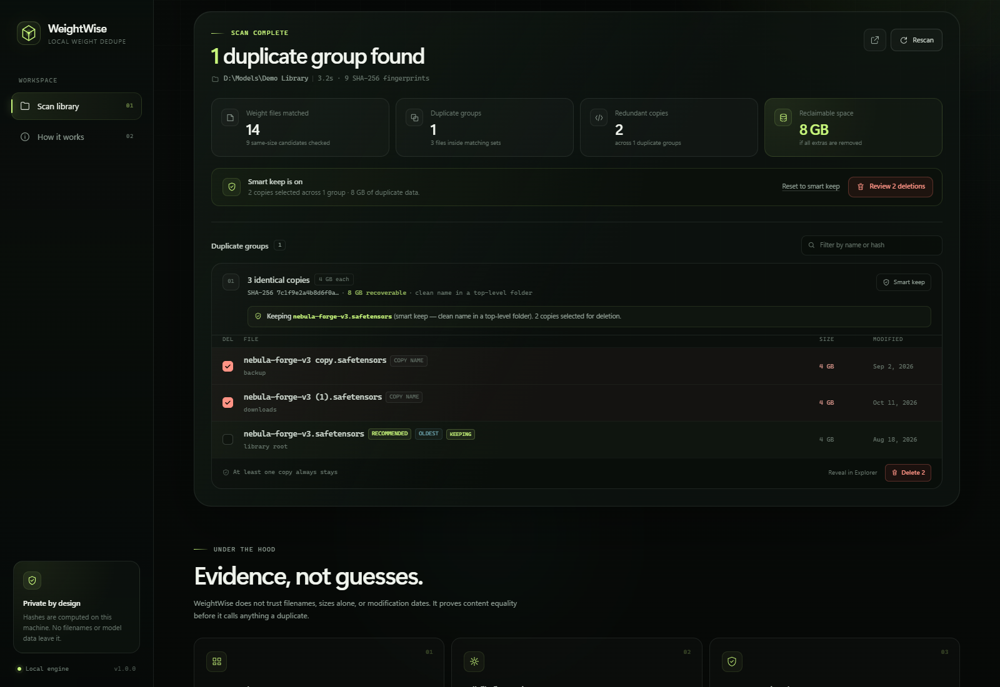

# WeightWise

A local, browser-based duplicate weight scanner. Point it at a model library, let it prove which files are byte-for-byte identical, review the smart keep choice, and remove the copies you no longer need.



*UI screenshot uses synthetic demo data. No real model files, filenames, or local paths are included in this repository.*

No uploads, no cloud service, no external Python packages.

## Run it

**Windows:** double-click `start.bat`. It starts the local engine and opens:

```
http://127.0.0.1:8765
```

Or from a terminal:

```powershell
python app.py
```

The console must stay open while you use the app. Press `Ctrl+C` to stop it.

Options:

```powershell
python app.py --port 9000          # use another port
python app.py --no-browser         # do not open a browser automatically
python app.py --root "D:\models"   # change the starting folder in the UI
```

Requires Python 3.10 or newer (tested on Python 3.13, Windows 11). There is nothing to `pip install`.

If WeightWise is already running on the chosen port, launching it again opens the existing instance instead of starting a duplicate server.

## What it does

1. **Inventories the folder.** By default it scans recognized weight formats, recursively, and skips symlinks, junctions, hidden items, and zero-byte files.
2. **Narrows by byte size.** Files with unique sizes cannot be byte-identical, so they are never read in full.
3. **Fingerprints the candidates.** Every same-size candidate is streamed through SHA-256 over its complete content. Same size alone is never enough.
4. **Groups only exact matches.** Filenames, extensions, and modification times are ignored when deciding equality.
5. **Recommends a keeper.** The default keeper avoids copy/backup/old-style names, prefers shallower paths, and then prefers the oldest copy. Every group is shown with the recommendation and the reason.
6. **Deletes with guardrails.** You review the copies, confirm, and choose a deletion mode.

## Safety model

- **One copy is always kept.** The UI prevents selecting the last copy in a group; the server independently rejects any request that would remove every copy.
- **Re-verified immediately before deletion.** The selected files and the copy being kept are re-read and re-hashed. If anything changed since the scan, nothing is deleted and you are told which files failed.
- **No arbitrary path deletion.** Delete/reveal requests only accept paths from the current scan result.
- **Default mode is the Recycle Bin** on Windows. Space is reclaimed when the bin is emptied. On drives where Windows cannot recycle a file, Windows may remove it permanently.
- **Permanent deletion is opt-in** and requires typing `DELETE`.
- **Local-only by design.** The server binds to `127.0.0.1`; API calls need a per-launch token embedded in the local page. It also enables a restrictive Content Security Policy and rejects non-loopback Host headers.
- **Read errors are reported, not hidden.** Locked or unreadable paths are skipped and counted in the scan notes.

The smart keeper is a deterministic set of rules (clean name, path depth, oldest timestamp), not an opaque model. You can change any selection before deleting.

## Supported weight formats

`.safetensors`, `.ckpt`, `.pt`, `.pth`, `.bin`, `.gguf`, `.ggml`, `.onnx`, `.ort`, `.engine`, `.plan`, `.trt`, `.tflite`, `.h5`, `.hdf5`, `.pb`, `.msgpack`, `.npz`, `.npy`, `.model`, `.params`, `.pkl`, `.pickle`, `.mlmodel`, `.sft`, `.litertlm`, `.task`, `.tflitemodel`

Turn off **Model weights only** in the UI to compare every file type.

## Files created at runtime

- `data/hash-cache.json` stores path + size + modification time + SHA-256 digest for unchanged files, so repeat scans are faster. It does not store file contents.
- The cache is local and disposable. Delete the `data` folder at any time.
- Scan results live in memory only; restarting the server clears them.

## Repository privacy

This repository contains source code and synthetic demo data only.

- Model weight extensions are ignored by `.gitignore`.
- The entire `data/` directory is ignored because the hash cache contains local absolute paths.
- The screenshot in this README is generated from fabricated demo data, not from a real library.
- Nothing is uploaded by the application; all scanning happens over loopback on the local machine.

Only explicitly reviewed source files are staged, so a broad `git add .` is not required.

## Tests

```powershell
python -m unittest discover -s tests -v
```

The suite covers the content-matching rules, cache reuse, smart keep, hard links, cancellation, folder scoping, the HTTP API, the one-copy guard, the typed permanent-delete confirmation, and the re-verification failure path.

## Layout

```
app.py             local HTTP server, folder browser, deletion engine
dedupe_core.py     discovery, full-content hashing, grouping, keeper logic
web/               dependency-free UI (HTML, CSS, JS)
tests/             automated tests
start.bat          double-click launcher
data/              created on first scan (ignored)
```
